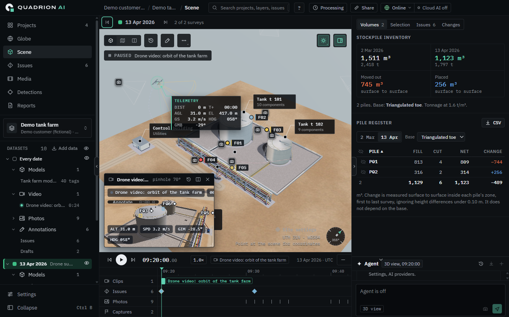

# The scene

**Scene** shows everything a project holds in one place: 3D models, point clouds, maps and orthos, video with the drone's flight, photos and panoramas, and the issues on them.

## Move around in 3D

- Drag with the left mouse button to orbit, with the right button to pan; the wheel zooms.
- **H** or **Whole site**: frame the whole project.
- **G** or **Centre on project**: frame the models and clouds, or without them what lies within 10 km of the project origin, so photos with a wrong GPS far away do not pull the view off the site.
- **F** or **Fly to selection**: fly to what you picked.
- **View presets**: **Iso**, **Top** or **North**. Clicking the compass also turns the view north-up from the top.
- **Esc**, or clicking the active tool again, returns to the pointer.

{product} remembers the camera for each project when you leave Scene and come back.

## The island: the stage tools and the date

The stage has no toolbar and no date bar. At the top centre of the view sits the island. At rest it shows the survey date you are viewing, for example "13 Apr", in the survey's colour; move the pointer near the top of the view and it grows to the date's arrows, the view and **Tools**.

- Click the date for the calendar: the month with the survey days marked, the survey list and **Compare the two dates**. **Alt ←** and **Alt →** step through the dates.
- Click the island, or press **T**, to open the stage tools: the **3D**, **Map** and **Split** switch, and a tab per group: **View**, **Measure**, **Display** and **Annotate**, and where the project has them **Point cloud**, **Volumes**, **Video** and **Road**. Pointing at a tab shows the group's quick tiles; clicking it opens the group's workbench, its full set, as a tab in the right panel (see [The right panel](#the-right-panel)), and the island goes back to rest. **All tools** at the end of a row does the same.
- The arrow keys move between the tiles, **Tab** moves between the rows, and **Esc** closes the tools.
- While something is going on, the island says it beside the date: a measurement and its reading, the playing clip with its telemetry, a processing job with its progress, or **Offline** when the network is down. Click the reading, or press **Space** on it, to bring its tab to the front of the right panel. When two things are going on, the second one is a small bubble beside the island; click it to swap them.

**T** no longer shows or hides the timeline: the timeline is the **Timeline** tile in the island's **View** group, and has no key.

## 3D, Map and Split

The switch at the start of the open island changes the view:

- **3D** (key **1**): the 3D view.
- **Map** (key **2**): a flat map with the orthos, plans and the offline street map.
- **Split** (key **3**): two views side by side. Each side has a selector, **Left side shows** and **Right side shows**: **3D view**, **Map**, **Video**, **Photos**, **Ortho and plans** or **Report**. Only what the project has is offered, and the 3D view can be on one side only.

Projects with more than one survey date also have **Compare dates**. See [Compare dates](04-compare-dates.md).

## Show and hide layers

- In the sidebar, **Datasets** has an eye per layer, one per group (Models, Point clouds, Maps, Video) and one at the top for everything. A half-filled eye means some layers in the group are hidden.
- In the island, the **Display** group's workbench (**Layers** at the end of its row) has **Layers and issue pins**, which turns kinds on and off: **Models**, **Point clouds**, **Photo cameras**, **Maps and rasters** and **Video clips**.
- The 3D view sits on the offline street map wherever an installed map pack covers the site: sharp under the site and running out to the horizon. The **Street map** tile in the island's **Display** row (**Hide the street map under the site**) takes it away and brings it back; the choice is remembered for the project on this computer. The **Map** chip at the top right of the 3D view puts an online map (Esri, Mapbox or Sentinel-2) or your imagery and terrain packs on the ground instead. See [The ground in 3D](06-maps.md#the-ground-in-3d).
- If you delete a layer you were looking at, for example photos placed far away by a wrong GPS, and the view is left on empty ground, the 3D view frames the project again.
- **I** or the **Issue pins** tile in **Display** turns the issue tags off and back on. **Issue pins** in the Display group's full set shows **All**, only issues at or above a severity, or **Off**, and the **Severity heat map**.
- **L** or **Labels** cycles the component labels: **Off**, **Key** (one per group) and **All**.

## Delete datasets and the project trash

In **Datasets**, right-click a dataset, a group heading (for example **Video**) or a survey date folder and choose **Delete…**. A dialog lists what goes:

- **Deletes:** the datasets you picked.
- **Also removes:** what was made from them, for example the map layers of a processing run, comparisons and 3D tilesets.
- **Keeps:** what stays, for example "3 issues will show 'Dataset removed'", or "Your original photos are not touched." A survey date that a volume, a survey check or a measurement still uses stays, and the dialog says so.

Click **Delete** to go ahead, or **Cancel**. "Everything goes to the project trash and is deleted for good after seven days." Deleting a survey date folder takes everything filed under it.

To delete several at once, mark the rows first:

- **Ctrl**-click a row to mark or unmark it; **Shift**-click marks every row from the last one you marked.
- From the keyboard: **Shift ↑** and **Shift ↓** extend the marks, **Ctrl Space** marks or unmarks the focused row, **Esc** clears the marks.
- While rows are marked, the header of Datasets reads, for example, **3 selected · Delete…**. Click it, or press **Delete**. **Delete** on a focused row with nothing marked deletes that row.

The project trash is a folder inside the project. While it holds something, a line at the foot of Datasets says how much, for example **Trash 12.3 MB · Empty**. **Empty** asks "Delete the project trash for good?" and **Delete for good** frees the space at once. The same is in the project's menu in the library: **Empty project trash**.

Deleting and marking are not offered in a read-only package or to a reviewer who may only look.

<!-- screenshot: delete-datasets.png | The Delete dialog over Scene in a demo project with a photo processing run: Deletes, Also removes (the run's map layers) and Keeps, with the seven-day trash note; the Trash line at the foot of Datasets in the background -->

## Data far from the project

When an import brings data that lies more than 10 km from the project origin, a notice **Far from the project origin** names each far layer and its distance:

- **Re-centre project here** moves the project origin to that data. Everything already in the project shifts with it, so nothing moves on the ground, and the project opens again. The notice then says where the origin is now; the previous `manifest.json` is kept as `manifest.json.bak`. A re-centre cannot be undone.
- **Keep** leaves the project as it is.
- When only photos lie far from survey data that is already in place, the camera's GPS is the likely culprit (a handheld camera's GPS can be kilometres out). The notice then offers **Ignore their GPS** instead: the photos stay in **Media** without a place on the map.

Re-centring is not offered when the project holds things that cannot move with it, such as issues, flights, walks, panoramas, drawings, photo processing runs, procedural models or a job that has not finished; the notice names them. **Ctrl K**, **Check where layers lie against the project origin** runs the same check at any time.

<!-- screenshot: far-data-notice.png | The "Far from the project origin" notice after importing a layer more than 10 km from the origin of a test project, with Re-centre project here and Keep -->

## Measure and cut

- **M** or **Measure a distance**: click two points. **Esc** clears it.
- **X** or **Section plane**: turn on **Section**, pick **Vertical** or **Horizontal**, set **Bearing** and **Offset**. **Keep other half** flips the side that stays.

## Point clouds

The island's **Point cloud** row has **Show** and the colour switch **RGB**, **Elevation**, **Intensity** and **Flight**. Click the **Point cloud** tab in the island for its workbench in the right panel, with every setting under **Colour, size and EDL**:

- **Colour by**: **RGB**, **Elevation**, **Intensity**, **Classification** or **Flight**.
- **Point size**: 1x is the normal size; 2x and 4x make points at least 2 and 4 pixels.
- **Point budget**: how many million points draw at once. More looks denser and needs a stronger graphics card.
- **Eye-dome lighting**: shades edges so shapes read better.
- **Elevation range** (with Elevation colouring): drag the sliders to stretch the colours; **Auto** resets them.

Detail streams in as you move: coarse first, finer after. The default budget follows the graphics preset (see [Graphics quality](12-settings.md#graphics-quality)).

### Put a floating cloud on the ground

A cloud whose heights are off (for example a cloud built from photo altitudes that the project corrects only for the photos) floats above the site or sinks below it. Fix it without changing its file:

- Right-click the cloud in **Datasets** and pick **Drop to ground**. The cloud's lowest point goes onto the ground, and a notice says how far it moved, with **Undo**. Press **Ctrl+Z** to take it back. You can mark several datasets and drop them together.
- The ground is the DSM under the item's footprint if there is one, otherwise the project ground level.
- In **Properties**, **Height offset (m)** shows the offset and can be edited. Type a value and click **Save offset**; the cloud moves at once, and **Undo** or **Ctrl+Z** takes it back. The street map lowers under the cloud as it does under a model, an orthophoto or an elevation model.
- The file is never rewritten. A cloud from a Bentley `.zpc` that names no height datum takes the project's photo altitude correction when imported, because it was built from the same uncorrected photo altitudes. The photos of a Bentley AT export take the same correction, so they stay with that cloud. A generic LAS or LAZ gets none, so use **Drop to ground** on it. Clouds in the kit format cannot be moved: convert them to COPC first.

## Clean up a point cloud

Click **Clean up** in the island's **Point cloud** group, or right-click a point cloud in **Datasets** and pick **Clean up...**. The panel opens as the **Point cloud cleanup** tab of the right panel and works on the selected cloud; with several clouds, pick one at the top. Cleanup works on COPC clouds only: convert others first.

Nothing is rewritten while you clean up. Every change is one step you can undo with **Undo** (**Ctrl+Z**) and redo with **Redo** (**Ctrl+Y** or **Ctrl+Shift+Z**), and the points come back when you undo.

- **Clip box**: **Fit to layer** puts a box around the cloud. **Edit box** shows handles: drag a face to move it (in steps of 10 cm), drag the ring above the box to turn it. **Keep** **Inside** or **Outside**. **Remove box** takes it away. The box works together with the section plane.
- **Height range**: type the lowest and highest elevation, or drag the two handles of the slider. Points outside are hidden.
- **Select points**: pick **Box** or **Lasso** and drag over the view (**Esc** cancels). The bar says how many of the loaded points you caught, then **Hide** (only in the view), **Delete** (left out of saves and exports) or **Set class**. A selection reaches through the whole cloud along your view, also the points not loaded yet.
- **Remove noise**: finds stray points in the air and under the ground and marks them as class 7 (Low noise), which is then hidden. It runs as a job; the panel then says how many points it marked. **Settings** has the number of neighbours, the distance limit and **Also mark low points**. **Undo** takes the run back.
- **Save cleaned copy**: writes a new point cloud layer, "<name> (cleaned)", without the deleted, clipped and hidden-class points. The original is hidden and its file is never changed.
- **Reset all cleanup** starts over (also one step you can undo). While the panel is open, the Classification legend shows and hides the classes of the cloud you clean up.

Right-click a point cloud in **Datasets** for **Clean up...**, **Remove noise...** and **Save cleaned copy...** (each opens the panel at its section), and **Reset cleanup** once you changed something.

Exporting a cloud with a cleanup (**Site data**, **Export survey data**) has **Apply cleanup**, on by default, with a line that says what it removes.

**Remove noise** and **Save cleaned copy** need the processing tools 0.12.0 or later (see [Processing tools](12-settings.md#processing-tools)).

## Sky, sun and water

Click **Sky and time** (**Environment and time of day**) in the island's **View** group (3D only):

- **Backdrop**: **Sky** (daylight from the real sun over the site) or **Studio** (a neutral dark backdrop for a single asset).
- **Time of day** slider and **Date**. **Capture time** jumps to when the data was captured; **Now** to the present.
- **Water** on or off and its **Level**, when the site has a sea level.
- **Project defaults** puts everything back.

Your choices are remembered per project.

## See inside the asset

For tanks, vessels and buildings flown inside, click **See inside** in the island's **View** group (**C**):

- **Off**: the asset is solid. Nothing is cut automatically.
- **Cut**: cuts the asset open toward you, at the drone while it is inside.
- **Transparent**: draws the asset see-through; set **Opacity**.

Point clouds hide while Cut or Transparent is on. **Inside view** flies behind the drone and looks where it looks.

## Video and the drone

Projects with video have a **Timeline** at the bottom. The **Timeline** tile in the island's **View** group shows or hides it; it has no key.

1. Click a clip bar on the timeline: the clip is selected and the playhead goes to that point. It does not play yet: **Space** (or the play button) plays and pauses, and playback runs on to the next clip of the same date. **Previous clip** and **Next clip** step through the clips.
2. The video window floats over the stage. Drag it by its title bar, resize it from the edges (it keeps 16:9), double-click the title to reset. **Dock beside the stage** puts it next to the view; **W** hides it.
3. **P** shows the flight paths (**All**, **Active clip** or **Off**).
4. **Follow the drone** keeps the drone in view. **Drone eye (through the camera)** looks through the drone's camera, so the video lines up with the model.

In the video window: **K** or **Space** pauses, **L** plays (press again for faster), **J** slows down, **,** and **.** step one frame.

On the timeline, the wheel scrolls along it and **Ctrl** with the wheel zooms at the pointer; **Zoom in**, **Zoom out** and **Fit** are in its header. The rate button cycles from 0.25x to 8x.

### One lane per survey date

In a project with video and survey dates (road surveys aside), the timeline has one lane per survey date, all on one time-of-day axis in site time (the header shows, for example, "site time ≈ UTC+3"), so flights flown at the same hour on different days line up.

- The lane of the date you are viewing is bright and tall, with clip names, issue diamonds, photo ticks and camera direction keyframes. The other lanes are dimmed and show a faint playhead at the same time of day.
- The date you view and two dates either side are shown. The others fold into **+2 earlier** or **+3 later**; click one to unfold that side.
- Clips that overlap on one date stack in rows. A date without video keeps a thin lane with its photos and issues.
- Click a date's label, or drag in its lane, to view that date. The time of day stays: if the new date has a clip at that time, it is selected, ready to play.
- The date you view sits in the top left corner of the timeline, and in the island. Click either for the calendar; **Alt ←** and **Alt →** step through the dates as before.
- The **Timeline** tile in **View** folds the timeline away and brings it back. The date stays in the island.

Projects without video, and road surveys, have the single timeline, and their date is in the island.

<!-- screenshot: timeline-date-lanes.png | Scene in a demo project with video on three or more survey dates: the lane timeline at the bottom with the bright focused lane, dimmed lanes with ghost playheads, a "+N earlier" fold and the date button in the top left corner -->

### Drone telemetry

**D** or the telemetry button turns it on and off (on by default):

- The flown path is solid up to the playhead, dashed after it.
- A shadow track on the ground with drop lines, and distance ticks from START.
- The HUD plate reads **DIST**, **T+**, **AGL**, **EL**, **GS**, **HDG** and **GMB**.

## Photos and panoramas

- Photos show as small rounded squares with a camera; panoramas as circles. Photos taken within 1.5 m share one marker with a count.
- Hover a marker for the count and the time span. Click it to open the photo; click a merged marker for a list with thumbnails.
- A panorama opens in an immersive view. The arrow keys look around; **Esc** or **Back to 3D** leaves.
- **Media** lists every flight, clip, photo set and panorama set. See [Media and findings](05-annotation-and-issues.md#media-and-findings).
- On the map, photos and 360s show as the same markers as in 3D. Hover one for its thumbnail. Click a photo to open it beside the map, or click a 360 to enter it with the 3D view beside the map.

## Photos and 360s without GPS

A ground photo or a 360 taken without GPS still comes in. Its Media tile says **Not placed** until you pin it on the site.

### Import

- **Add data** finds 360s by their shape (an image twice as wide as it is high). If some have no GPS, the offer says so: they import as not placed, ready to pin. A 360 with no GPS imports on any project, including one with a plain site grid. A 360 with GPS, and drone spheres to stitch, are placed on the map, so they need a coordinate system given as an EPSG code; on a site grid the import lists them as needing one and leaves them out.
- Insta360 `.insp` stills import like JPEGs. A still the camera has not stitched yet is two fisheye circles, not a 360. It is left out, and the offer says why: export it as a 360 photo from Insta360 Studio first, then add the exported file.

### Place on site

1. Right-click the photo or 360 (its Media tile, its row, or its marker) and choose **Place on site**. A strip at the bottom of the scene says what to click next.
2. Click where it was taken: on the model, the point cloud or the map. The pin sits on the surface you clicked, and the camera sits **Eye height** above it (1.6 m unless you change it on the strip). On the map with no model under the point, the strip says the height is unknown and the pin sits at 0 m.
3. For a 360, line it up with landmarks. The 360 opens beside the view. Click a landmark in the 360, then the same landmark in the 3D view or on the map. One pair lines it up. A second pair refines it (the two are averaged). If the two pairs disagree by a lot, the first one is kept and the strip says so.
4. For a photo, click the direction it looks, or press **Done** to leave it without one. In 3D you can also drag the pin's arrow to turn it.
5. **Done** ends placing. Each click saves straight away. **Cancel** or **Esc** keeps what is saved.

A pinned 360 that is not lined up yet says **Not lined up yet** on its tile. Once placed, a photo or 360 has a marker like any other: hover for a preview, click to open.

### Move, turn or remove a pin

Right-click the pin (in 3D or on the map) or the tile:

- **Move pin**: click the new place. The heading stays.
- **Set direction**: line a 360 up again, or aim a photo again.
- **Remove pin**: the item is **Not placed** again. A photo or 360 that came with GPS goes back to its GPS place and direction.

### Treat as 360, Treat as photo

A photo whose image is twice as wide as it is high shows **Looks like a 360** on its tile. **Treat as 360** (on the tile or in the photo's menu) moves it to the 360s of its survey date. **Treat as photo** on a 360 moves it back. The file stays where it is, and a pin goes with it. Neither is offered in a package. A photo with marks on it must have them removed first, and a stitched drone panorama cannot become a photo.

## The right panel

The right panel (the right sidebar) is the workbench: one row of tabs over the front tab's content, and the AI agent below it.

- **The tabs.** From the left: what is live (a measurement being drawn, the annotation tools, the playing clip, the jobs running), each with a small dot; the workbench or panel you opened from the island; then **Selection**, **Issues**, and on the projects that have them **Volumes** and **Changes**. A tab that does not fit goes into the **More tabs** menu at the end of the row; its count says how many are there.
- **Following what you do.** A tool you start brings its tab to the front: **M** opens **Measure**, **A** opens **Annotate**. Picking an issue shows its card in **Selection**, and **Show changes** brings **Changes**. While an issue's **Edit issue** form is open, a tool that starts does not take the front from it: its tab waits beside it with its dot, and you click it when you want it. When the tool stops, the tab it opened closes again.
- **Pin.** A workbench or panel opened from the island replaces the one opened before it, and closes when a tool starts. **Pin** on its tab keeps it: a pinned tab stays until you close it with its **X**, and it is there again the next time you start {product} on this computer.
- **Sections.** A workbench is made of sections with a title and a count; click a title to fold it. **Collapse all** at the top folds every section, and **Expand all** opens them again. The open sections are remembered per workbench on this computer. In **Measure**, **Search tools** keeps only the tools whose names match, for example "slope" leaves **Grade and slope** under **Line**.
- **Width.** Drag the panel's inner edge to make it wider or narrower; it keeps that width the next time. **Volumes** and **Changes** open at least 470 px wide while they are in front, so their tables fit.
- **The agent.** It sits below the workbench. While the AI is off it is one row, **Agent off · Turn on**. **Maximise** in its header gives it the whole panel; **Restore**, or a click on a tab, brings the workbench back. **Minimise** folds it to one line, **Ask about** and what is in view; click the line to open it again. Drag the divider between the workbench and the agent to share the height; a double-click on it goes back to the usual share. While a tool is live the agent folds to its line, unless you have sized it.

The tab on its left edge, **Ctrl Alt B**, the right-panel button at the top right of the stage or **Right panel** in the island's **View** group folds the panel away and brings it back; folded, the panel is a thin strip at the edge of the window, a click on the strip opens it, and the right-panel button sits to the left of the window's own buttons. **Ctrl J** opens the panel and puts the cursor in the agent. The 3D view, the map and the video take the room. Picking an issue or clicking **Show changes** opens the panel again, because they show their result there; selecting a layer does not.

**The drawer.** With the panel folded, a tool you start, or a workbench you open from the island, slides its tab in over the right edge of the view as a drawer, without the agent. The panel stays folded and the view is not resized. **Esc** slides the drawer out, and it goes by itself when the tool ends.
