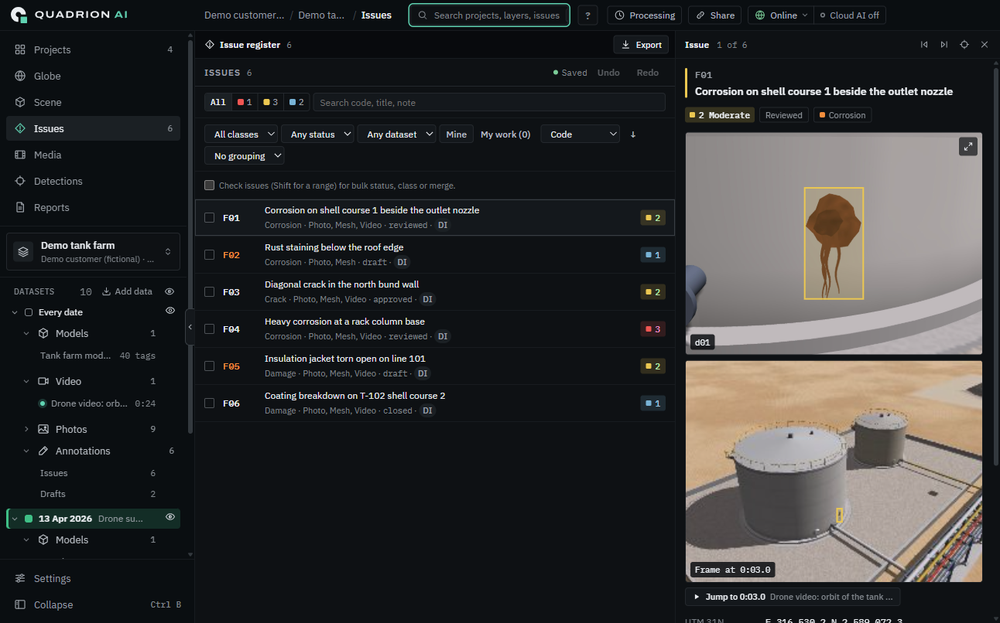
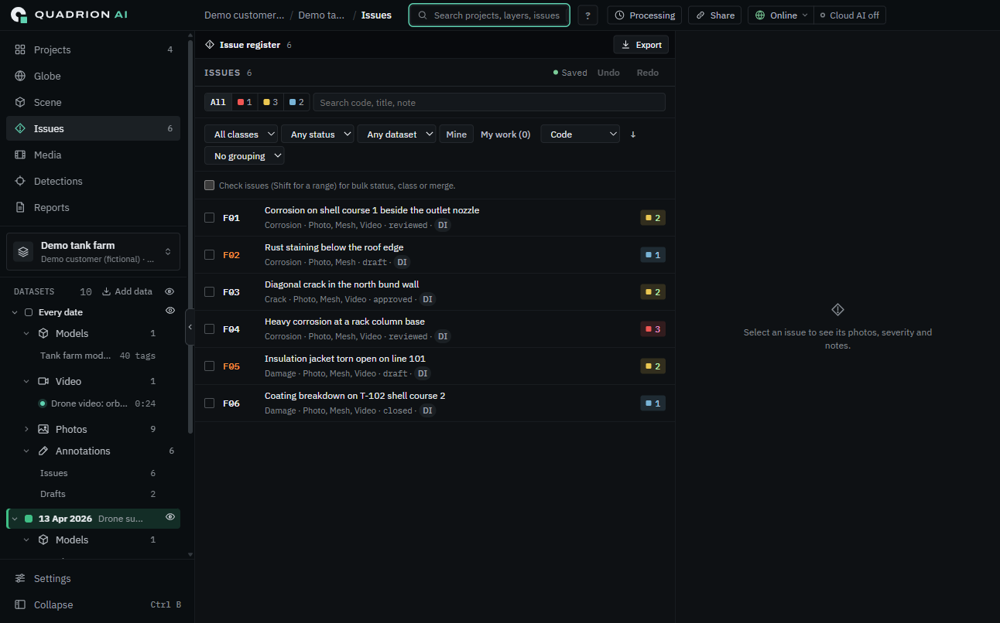

# Annotation and issues

An issue is one defect or finding: a code, a title, a class, a severity and a status, marked on the model, the map, photos or video frames.

## Mark a new issue in 3D

1. On **Scene**, open the island's **Annotate** group and click **Annotate** (**Annotate: pins, lines, areas, cloud regions**), or press **A**. A tool bar opens under the island.
2. Pick a tool: **Pin**, **Line**, **Area**, **Cloud pt** or **Cloud box** (point clouds).
3. Click on the model. For a line or an area, click each point and finish with **Enter** or a double click.
4. In **New issue**, pick the **Class** and the **Severity** (number keys; **U** for uncertain).
5. Click **Create issue** (or press **Enter**). **Add to** an existing issue code instead adds the mark as another sighting of that issue.

On the **Map**, the tools are **Point**, **Line** and **Area**.

To close the tools, click **Close the annotation tools** or press **A** again. Packages opened read-only have no annotation tools.

In a project with survey dates, an issue belongs to the date of the layers it is marked on. Its pin and shape go off the 3D view and the map when that date is hidden and come back when it is shown; the **Issues** list always holds every issue. See [Survey dates](28-survey-dates.md).

## Mark an issue on a photo or a video frame

1. Click **Inspect** in the sidebar and pick the photo on the left, or open it from a marker in the scene.
2. Pick **Box** (**B**), **Rotated box** (**R**), **Polygon** (**P**) or **Point** (**O**) and draw on the defect.
3. Pick the class and severity as above. Your last class and severity are filled in, so a repeat finding is a drag and **Enter**.

That is about four actions: pick the photo, pick the tool, draw, confirm. Everything else about the screen is under [Inspect](#inspect).

On a video frame, pause the clip and use **Box** or **Polygon**.

## The issue card

Pick an issue anywhere: a pin or code label in 3D, a map marker, a timeline mark, a row in **Issues**, or **Ctrl K**. The right panel opens with its card:

- Code, title, severity, status (**Draft**, **Reviewed**, **Approved**, **Closed**), class, **Zone** and its place in the list ("4 of 31").
- The best photo cropped around the defect with its box drawn; the other photos in a strip. A video frame has **Jump to** with the time: the clip plays from there.
- **Recommended action** (from the severity model) and **Note**.
- **Previous issue**, **Next issue** and **Fly to the issue**.

### Edit an issue

Open **Edit issue** at the bottom of the card:

- Change **Title**, **Class** and **Severity**, and write the note.
- Move the status on with **Mark reviewed**, **Approve** or **Close** (**Back to** returns it a step).
- Merge two records of the same defect.

Changes save into the project at once.

### Look at the photos full size

1. Click the photo on the card. It opens over the app.
2. Wheel to zoom, drag to pan, **F** to fit.
3. **M** turns the markings off and on. Left and Right step through the issue's photos.
4. **Open in Inspect** shows the photo with every finding marked on it. **Esc** closes.

### Evidence beside the 3D view

When you pick an issue in the 3D view, the stage switches to **Split** with the issue's photo (or video frame) on the other side, and the 3D view flies to the issue. **Esc** or **×** restores your layout.

To open only the card, switch off **Open evidence in split** on the card.

## The issue register

Click **Issues** in the sidebar.

- Filter by severity, **Search code, title, note**, class, status and dataset. The filters stay as you set them while the project is open, on this screen and in the issue list of the **Scene** panel alike, and reset when you open another project.
- When the agent opens the register on one asset or area, a chip above the list names it. Click the **x** on the chip to clear it. See [Show me](07-ai-agent.md#show-me).
- Sort by **Code**, **Severity**, **Status**, **Last change** or **Class**; group by severity, class, zone or status.
- Tick several rows for **Set status**, **Set class** or **Merge**.
- Up and Down (or **J** and **K**) move through the list; **Enter** opens the issue. **Ctrl Z** undoes, **Ctrl Y** redoes.
- **Export** saves the issues. See [Reports and exports](10-reports-and-exports.md).

## Inspect

**Inspect** is the one screen for photos, drawing and AI. It replaces the old **Media** and **Detections** screens: you look at the photos, draw findings, ask the AI to look and confirm what it suggests without leaving it. Click **Inspect** in the sidebar.

### The three columns

- **Left: the photos.** The flights and clips (**Play in the scene**), the photo sets and the panoramas, grouped as before.
  - Chips filter the list: **To review** (photos with AI suggestions waiting), **With findings** and **All**, each with a count.
  - Every tile shows up to two badges: an orange count of AI suggestions waiting, and a count of confirmed findings in the colour of the worst severity. A colour key sits at the bottom.
  - Click picks one photo, **Ctrl**-click adds or removes one, **Shift**-click adds the range up to it.
  - **Filter** next to the chips holds the **Severity** (**Any**, or one level of the project's severity models, worst first, and **Uncertain** when a model has it) and the **Order**: **As captured**, **Worst first** or **Most findings first**.
  - A chip above the photos, for example `On Tank T-101`, shows a filter the agent set on an asset, an area or one finding. Click its **x** to clear it. See [Show me](07-ai-agent.md#show-me).
  - Right-click a tile for the same actions as before: place, move, direction, as 360, as photo, remove and **Edit position**.
- **Centre: the photo.** The drawing tools (**Select**, **Box**, **Rotated box**, **Polygon**, **Point**), **Ask AI** with its scope buttons, the photo's name and its place in the list ("14 of 312"). Wheel to zoom, drag to pan.
  - Findings you confirmed are drawn solid, in their severity colour.
  - AI suggestions are drawn dashed and orange, with a small label: the class, the confidence, and a tick and a cross to accept or dismiss it.
- **Right: Findings on this photo.** One list for yours and the AI's, each with a **YOU** or **AI** chip (with the confidence), its class and its severity.
  - A suggestion has **Accept** (**A**), **Change** and **Dismiss** (**D**).
  - **Draw a finding** (**B**) starts the box tool.
  - At the bottom, "n photos still have AI suggestions to check" and **Next photo to review**.

At about 1100 pixels wide, the right column becomes a drawer opened by **Findings (n)**, so the photo keeps the room. Packages opened read-only let you look, filter and step through photos, but not draw, ask the AI or accept: the screen says so.

On the photo list, **J** and **K** step to the next and previous photo. In the review queue they step through the suggestions, and **Shift J** and **Shift K** move to the next and previous photo or frame (the full list is in [Inspect and review](12-settings.md#inspect-and-review)). Opening an issue's photo from **Issues**, a marker in the scene or the map brings you to **Inspect** on that photo with the finding picked.

### Draw a finding

Pick a tool, draw on the defect, and pick the class and severity once; your last choice is filled in. The finding is an issue with a sighting, listed in **Issues** at once. See [Mark an issue on a photo or a video frame](#mark-an-issue-on-a-photo-or-a-video-frame).

### Ask AI

**Ask AI** is the one button for every kind of AI: cloud vision, a local detector or a local ONNX model. You are not asked which one.

1. Click **Ask AI** and pick what to **Look at**: **This photo** (the default when nothing is picked), **Selected (n)** or **All (n)**. **Frames...** picks a clip or a walk and **One frame every** some seconds.
2. If you want, pick what to **Look for**: **Everything in this project's classes**, or one installed detector. Your last choice is remembered for the project, so a repeat run is one click.
3. The run starts. A strip at the top reads "AI is checking n photos for ... · k done · suggestions appear as they arrive", with a bar and **Stop**. Suggestions appear on the tiles and in the list as each photo finishes.

Which AI looks is set once in **Settings**, **AI providers**, **AI for Ask AI** (see [AI for Ask AI](12-settings.md#ai-for-ask-ai)). With **Automatic**, {product} uses an installed local detector for your check, then the local ONNX model, then cloud AI if the project's AI policy allows it. If none can run, the button says so and **Open AI settings** takes you there.

**A cloud run asks first.** A local run starts straight away, with nothing sent. When the AI that would look is cloud vision, a line shows before anything leaves the computer: "Send 12 photos to Anthropic, about $0.40?" with **Send**, **Cancel** and **Don't ask again for this project**. **Preview what is sent** shows the exact images, one click away. The estimate and the preview are the ones the old **Detect with AI** dialog showed. The project's AI policy still decides whether cloud AI is allowed at all, and cloud AI needs its key and the switch (see [AI agent](07-ai-agent.md)).

The steps, counted by the click:

| You want                         | Actions                                  |
| -------------------------------- | ---------------------------------------- |
| Draw a finding on one photo      | About 4                                  |
| AI on one photo, then confirm it | About 3 (one more when the run is cloud) |
| AI on all photos                 | 3, then one key per result               |

If a run fails or you stop it, the suggestions that already arrived stay. The strip says what happened and offers **Try the n left again**.

Nothing the AI suggests counts as a finding until a person accepts it. Suggestions never reach **Issues**, the exports or a report unaccepted.

### Review the AI's suggestions

On one photo, use the right list: **Accept** (**A**) turns the suggestion into a confirmed finding with your last class and severity. When the suggestion has no class, or its class or severity does not fit, **Accept** opens the class and severity picker instead. **Change** opens the same picker, then accepts. In it, **Same as an existing finding...** (**L**) adds the mark as another sighting of an issue you already have, so the same defect is not logged twice. When the AI named something the project has no class for, the picker offers **Add "name" as a class**. **Dismiss** (**D**) throws a false alarm away. **Reopen** takes a decision back.

After a bigger run, click **To review**, then **Review n suggestions**. The right panel becomes the **Review queue**, and the photo in the middle follows it:

- the progress ("14 of 86") and a chip per class with its count;
- a zoomed crop of the suggestion, with its class and severity pickers;
- **Accept** (**A**), **Fix** (**F**: redraw or relabel, then accept) and **Not a fault** (**D**);
- **Accept all** Corrosion **above** 80% and **Reject all** for the class, for the class you filtered to;
- **Lowest confidence shown**, a slider. Suggestions under it are hidden and not counted in **To review**. It is the only bar: a local detector's suggestions scored under its own threshold show once the slider is under their score. It starts at 50%, or at the value in **Settings**, **AI for Ask AI**;
- **Ctrl Z** and **Ctrl Y** undo and redo, a whole batch at a time, and the **Accepted** and **Rejected** filters show what you have decided.

**Esc**, or finishing the queue ("Every suggestion here is checked."), takes you back to the photos. The state reads **Saved** once your decisions are in the project. The keys are in [Inspect and review](12-settings.md#inspect-and-review).

Video frames and 360 frames the AI looked at show in the queue too, named after the video and the time.

AI suggestions are drafts kept in the project's `detections` folder. Accepting one turns it into a draft issue. **Open in Issues** shows it.

## Severity models

Each project grades issues with its own severity model: levels with a colour, criteria and a recommended action. **Settings**, **Severity models** shows the models of the open project. You choose the first model when you create a project. While you annotate, **New class** can also generate another scale, **1 to 3** or **1 to 5**, and you can rename the grades before it is saved. Scales already in the project are not edited here.

## Classes

Each project sorts findings into classes: a name, a colour, an optional hotkey and the severity scale its issues are graded on. **Settings**, **Classes** lists the classes of the open project.

- **Rename** a class in its name field and press Enter. **Colour** opens the palette. **Hotkey** takes one letter, not `a` or `u` (the sighting picker uses those) and not a digit (digits pick severity).
- **Severity scale** can be changed while no issue uses the class.
- **Delete** a class nobody uses at once. When issues or waiting AI suggestions use it, you pick the class that takes them over; their severities move to the nearest level of that class's scale.
- **Save to my class library** keeps the class on this computer. A new project offers library classes under **From your class library**.
- **Ctrl+Z** in the page, or **Undo** on the notice, takes the last class change back.

You can also make a class while you work. After a shape, the class panel lists the classes with room to search them and shows each grade of the selected class by name. **New class** asks for a name, a colour, an optional hotkey and a severity scale (one the project has, or a new one). **+ New class...** in **Set class** of the Issues register, in the class field of a suggestion, or in the class mapping of a local model (**Settings**, **AI for Ask AI**) still takes just the name: type it and press Enter.
