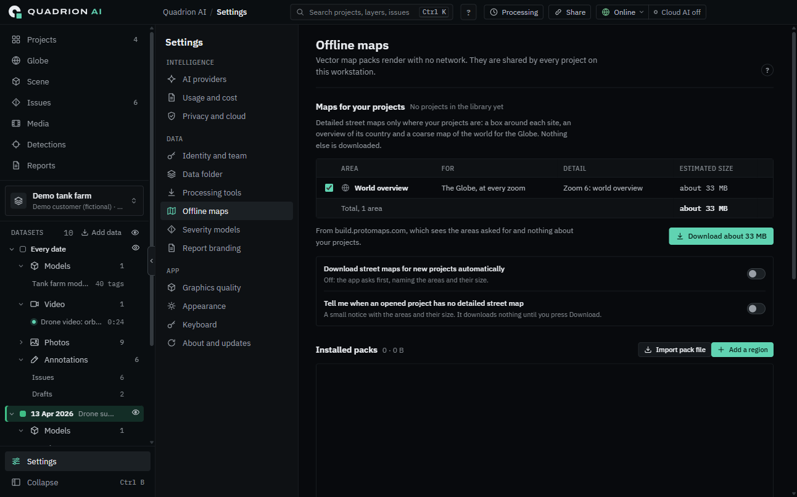

# Maps and offline packs

Street maps come from offline map packs on your disk. One pack serves every project in its area. Orthos and plot plans of a project always show, with or without a pack. If you want them, online maps (Sentinel-2, Esri and Mapbox) can be switched on as well: see [Online maps](#online-maps).

## The map view

1. On **Scene**, click **Map** (or press **2**).
2. Drag to pan, wheel to zoom. Issues show as markers; click one for its card.

Street maps are dark, also in the light theme. With no pack installed, the map says "No map packs installed. Add a pack in Settings, Maps."

### The Map menu

The Map view, the 3D scene and the Globe share one **Map** menu. Its chip sits at the top right of the view, under the zoom buttons, and shows a small picture and the name of the map in use, for example **Mapbox Streets**. Click it to open the menu:

- **Offline**: **Streets**, the street map from your packs (the Globe also has **Natural Earth**).
- **Online satellite**: **Sentinel-2**, **Esri** and **Mapbox**.
- **Mapbox styles**: **Streets**, **Outdoors**, **Light**, **Dark** and **Satellite streets**.
- **On top**: switches for what lies over the map. In the Map view: **Street names and roads**, **Terrain shading** and **Imagery packs and orthos** (with an **Imagery pack** list, **Best available** to draw them all, detailed over coarse). A switch that does not apply is greyed with the reason under it, for example "No imagery pack covers this site" or "This map has its own street names".
- The footer credits the map that is drawn and has **Map sources**, which opens the Settings page with the online maps and their keys. A Mapbox map adds **Improve this map**, which opens Mapbox's feedback page in your browser.

Picking a map keeps the view where it is. The choice is remembered on this computer. A tile that cannot be picked is greyed with a badge and a note: **Key** ("Add a key in Map sources"), **Offline** ("This workstation is offline-only") or, in the 3D scene, **Medium** ("Needs Medium graphics or higher").

If the map you chose cannot be drawn right now (no key, online maps switched off, or the workstation is offline-only), the offline street map is drawn instead and the chip says **Offline map**.

From the keyboard, the arrow keys (and **Home** and **End**) move across the maps and pick as they go, **Tab** moves to the switches and the footer, and **Esc** closes the menu. The command palette (**Ctrl K**) has the same choices: type "map" for **Map: Streets**, **Map: Esri** and the others, **Turn terrain shading on the map on**, and **Turn online maps on**.

<!-- screenshot: map-menu.png | The Map menu open in the Map view of a demo project placed on the Earth, with online maps on: the Offline, Online satellite and Mapbox styles tiles, the On top switches and the Map sources link in the footer -->

Imagery and terrain packs come from your disk. A map type with no imagery for the site is greyed out and says which pack is missing. See [Imagery and terrain packs](31-imagery-and-terrain-packs.md).

### The ground in 3D

In 3D, the same **Map** chip sits at the top right of the view, once the project is placed on the Earth. It chooses the ground around the site:

- **Streets**: the offline street map under the site, sharp there and running out to the horizon, wherever an installed pack covers the site. It sits just under the lowest model, point cloud, orthophoto or elevation model that is showing, so a survey below the project origin is not buried under it. Turn it off and on in the **Street map** section of the Display workbench; the choice is remembered for the project on this computer. The button is greyed out when no installed pack covers the site.
- An online map (**Esri**, **Mapbox** or **Sentinel-2**): the imagery lies on the ground around the site in place of the plain grey ground. Needs Medium graphics or higher.
- **On top** has **Imagery packs around the site** and **Terrain around the site**, which drape your imagery packs and the relief on the land around the site. They also need Medium graphics or higher and a pack that covers the site.

A projected drone video still drapes onto whatever ground is showing.

## Offline map packs

Open **Settings**, **Offline maps**. **Installed packs** lists each pack with its **Region**, **Size**, **Max zoom**, **Built** date and **Bounds**.

### Maps for your projects

**Maps for your projects**, at the top of the page, gets detailed street maps only for the places where you have projects, and nothing else. It says how many projects lack one, for example "3 of 7 projects have no detailed street map", and lists the areas that would fix it:

- **Site area**: a box of 12 km around each site at full detail (zoom 15). Sites close to each other share one box. Well under 1 MB each.
- **Overview** of each country that has a project (zoom 10, coarser for the largest countries). From about 0.2 MB for a small country to a few tens of MB for the largest.
- **World overview**: the whole world at zoom 6, about 33 MB, so the Globe shows a street map at every zoom.

Each area shows its **Estimated size**, and the last row the total. An area that an installed pack already covers is not listed.

1. Untick any area you do not want. **Show** draws it on the coverage map.
2. Click **Download**. The button shows the total, for example "Download about 36 MB".

The areas appear under **Downloads** and install like any other region, with the same **Resume** and the same check. The download comes from build.protomaps.com, which sees the areas asked for and nothing about your projects.

When everything is covered, the panel says "Nothing to download". A project that is not placed on the Earth (a local grid, or a coordinate system {product} does not know) gets no map.

**When you open a project** that has no detailed street map, a small notice at the bottom right names the same areas and their size. **Download** starts them, **Choose areas** opens this panel, and closing the notice is fine too: it does not come back for that project. Turn the notice off with **Tell me when an opened project has no detailed street map**.

**Download street maps for new projects automatically** is off by default. With it on, the first time you open a project that is placed on the Earth, its missing areas are queued in **Downloads** without asking; a notice says so, and you can cancel them there.

In **Offline only** nothing is downloaded, whatever these switches say. The panel still lists what is missing: switch to **Online** in the status row at the foot of the left sidebar (see [Online or offline only](01-install.md#online-or-offline-only)), or bring the packs in with **Import pack file**.

If a project leaves the library, the panel says, for example, "2 packs cover areas with no project any more". Click **Review**, then **Remove** on a pack and confirm. The world overview is never offered for removal.

### Import a pack file

Use this on a workstation with no network.

1. Click **Import pack file**.
2. Pick a `.pmtiles` file (for example from a USB drive).

The pack appears under **Installed packs**.

### Download a region

{product} downloads map data only when you start it (or have turned on **Download street maps for new projects automatically**, above), from build.protomaps.com. The workstation must be **Online**: click the mode in the status row at the foot of the left sidebar, switch to **Online**, then **Download maps** (see [Online or offline only](01-install.md#online-or-offline-only)). In **Offline only**, **Download** is greyed and the page says to import a pack file instead.

1. Click **Add a region**.
2. Pick the area: **Country** (choose from the list) or **Draw a box** (drag on the map).
3. Give it a **Region name**.
4. Pick the **Detail**, from **Zoom 6: country overview** to **Zoom 15: full detail**. The size estimate updates.
5. Click **Download**. The button shows the size, for example "Download about 120 MB".

**Downloads** shows the progress. If the download stops (network, or you quit {product}), it shows **Interrupted**: click **Resume** to continue from where it stopped. The finished pack is checked tile by tile.

If the workstation is set to offline-only, downloads are off: "This workstation is offline-only. Import a pack file, or turn off offline-only in Privacy and cloud."

### Remove a pack

Click **Remove** on the pack's row, then confirm. Maps lose that area until the pack is added again. A pack that came with an open package shows **In open package** and cannot be removed.

## Online maps

Not every workstation has to work offline. Online maps draw imagery or styled maps of the whole world without a pack. They are off until you switch them on.

| Map                    | Key                                                                         | Kept on this computer      |
| ---------------------- | --------------------------------------------------------------------------- | -------------------------- |
| **Sentinel-2 (EOX)**   | None. Imagery from 2016, about 10 m per pixel                               | Yes, up to 300 MB of tiles |
| **Esri World Imagery** | Optional. A key from an ArcGIS Location Platform account uses its allowance | No                         |
| **Mapbox**             | Needed: a public access token from a Mapbox account                         | No                         |

### Switch them on

1. Open **Settings**, **Map sources** (or click **Map sources** in the footer of the Map menu).
2. Switch on **Online maps**. The first time, a notice names the provider and what it can see: read it and click **Switch on**. Nothing is requested before that.
3. In the Map menu, pick **Esri**, **Sentinel-2**, **Mapbox** or a Mapbox style.

Picking an online map in the Map menu while online maps are off shows the same notice first. **Ctrl K**, **Turn online maps on** does the same and opens **Map sources**.

### Add a key

1. In **Settings**, **Map sources**, find **Esri World Imagery** or **Mapbox**.
2. Paste the key in **Paste the key** and click **Save key**. {product} asks the provider for one tile to check it, then says "The key is saved on this computer."
3. **Test** checks a saved key again ("The key works."). **Remove** takes it off this computer.

Each row says **Works without a key**, **No key** or **Key saved**. Keys are kept per computer in the system credential store. They never enter project files, packages or logs, and {product} never shows them again.

<!-- screenshot: settings-map-sources.png | Settings, Map sources with Online maps on, the Sentinel-2, Esri World Imagery and Mapbox rows, and a saved Mapbox key showing Key saved with Test and Remove -->

### What is sent

- {product} requests the tiles for the areas you look at from the provider you picked (EOX, Esri or Mapbox, with your key where you added one). That provider can therefore see which areas you view, and the address your computer connects from. Nothing else is sent: no project data and no account details.
- Requests beyond a provider's free monthly allowance are billed to the account of the key.
- Sentinel-2 tiles you have viewed are kept on this computer (up to 300 MB; the ones used longest ago make room for new ones), so those areas draw again without a request. **Clear saved satellite tiles** at the bottom of **Map sources** deletes them and shows how much they take. Esri and Mapbox tiles are not kept.
- The credit of the map you see shows in the footer of the Map menu. Sentinel-2 imagery is licensed CC BY 4.0.

What you get from Sentinel-2: the lie of the land, roads and large structures, not site detail, and nothing built since 2016. Esri and Mapbox imagery is sharper. Zoomed in past the detail a source has, the imagery is stretched, not sharper. Your imagery packs and the project's orthos draw over an online map.

On an offline-only workstation online maps cannot be switched on: the tiles in the Map menu are greyed with **Offline**, and **Map sources** says "This workstation is offline-only, so online maps cannot be switched on. Turn off offline-only in Privacy and cloud." Sentinel-2 areas you viewed before can still draw from this computer. When a provider cannot be reached, the map shows what it has.

For imagery that works with no network, or sharper imagery of your site, use an imagery pack. See [Imagery and terrain packs](31-imagery-and-terrain-packs.md).

## Maps inside packages

A package can carry the map region around its site, so the customer sees street maps with no pack installed. See [Packages](11-packages.md#include-the-map-region).
