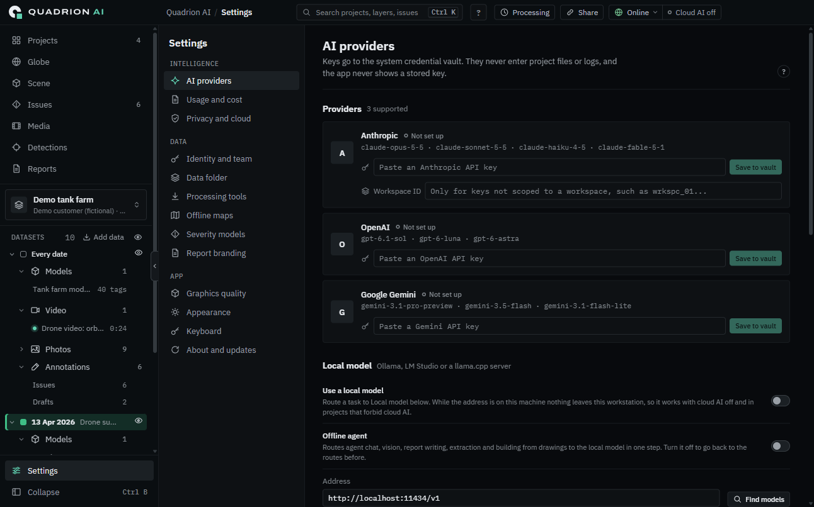

# AI agent

The agent answers questions about the open project and does things for you: moves the camera, plays a clip at a time, takes you to a finding, opens **Media** or **Issues** already filtered, lists and summarises issues and changes, and prepares changes (a draft issue, a comment, a CSV export, a processing run) that wait for your **Approve**. It uses a cloud AI provider with your own API key, or a local model on this workstation.

Cloud AI is off until you switch it on. Nothing leaves the workstation while it is off.

## Add a provider and a key

1. Open **Settings**, **AI providers**.
2. Under **Providers**, find **Anthropic**, **OpenAI** or **Google Gemini**.
3. Paste the key in the field (for example **Paste an Anthropic API key**) and click **Save to vault**.
   - The key goes to the system credential vault. It never enters project files or logs, and {product} never shows it again.
   - To change it, click **Replace key**.
4. Click **Test connection**. It sends one short message to check the key and the model.

### Anthropic workspace ID

Some Anthropic keys are not tied to a workspace. Then every request must name one:

1. In the Anthropic Console, copy the workspace ID (it looks like `wrkspc_01...`).
2. In **Settings**, **AI providers**, enter it in **Workspace ID** under Anthropic.
3. Click **Test connection** again.

If the agent stops with this error, it shows a **Workspace ID needed** card: enter the ID in **Anthropic workspace ID** and click **Test and retry** (it sends your last message again, once). **Open AI settings** takes you to the field.

### A local model

Under **Local model**, switch on **Use a local model** and enter the **Address** and the **Model** of a server on this workstation (Ollama, LM Studio or a llama.cpp server). Nothing goes to the cloud. **Offline agent** runs every task on it. See [Set up a local model](20-local-model.md).

### Which model does what

**Model routing** lists each task with its provider and model, and what it **Sends**:

| Task                   | Sends              |
| ---------------------- | ------------------ |
| Agent chat             | Text, view context |
| Photo and frame vision | Frames, crops      |
| Report writing         | Issue text         |
| Structured extraction  | Text, tables       |
| Build from drawings    | Drawings, clouds   |

**Reset to defaults** puts the routes back.

While the Model builder is open, the agent uses the **Build from drawings** route. Plan images and drawings go to a cloud model only when the project allows it. See [Allow cloud AI for drawings](18-model-builder.md#allow-cloud-ai-for-drawings).

## Switch cloud AI on

1. Open **Settings**, **Privacy and cloud**.
2. Switch on **Cloud AI**. The title bar chip changes from **Cloud AI off** to **Cloud AI**.

**Ctrl K**, **Turn cloud AI on** does the same. Clicking the cloud AI chip in the title bar opens **Privacy and cloud**. The workstation must be **Online** (see [Online or offline only](01-install.md#online-or-offline-only)): in **Offline only** the **Cloud AI** switch is greyed. A package can forbid cloud AI: then the chip reads **Cloud AI blocked** and nothing from it is sent.

### On an offline-only workstation

With **Offline-only workstation** on (**Settings**, **Privacy and cloud**, or the switch behind **Offline only** in the title bar), cloud AI is off whatever the **Cloud AI** switch says.

- Nothing goes to Anthropic, OpenAI or Google Gemini: not from the agent, **Detect with AI**, **Draft with AI** or **Test connection**. This holds from the moment you switch it on. A reply under way stops before its next step.
- The **Cloud AI** switch shows off and is greyed. The title bar reads **Offline only** and **Cloud AI blocked** (**Cloud AI off** when the switch was off already).
- The agent reads **The agent is off**: "Cloud AI is off because this workstation is offline-only. A local model on this machine can still be used. To use cloud AI, turn off Offline-only workstation in Settings, Privacy and cloud."
- A local model on this computer keeps working. See [Set up a local model](20-local-model.md). A model server on another machine counts as cloud AI and is refused.

Switch **Offline-only workstation** off, or click **Offline only** in the title bar and switch to **Online**, to use cloud AI again. The **Cloud AI** switch goes back to what you had set.

## Talk to the agent

The agent sits at the bottom of the right panel on **Scene** (open the panel with **Ctrl Alt B** if it is folded). On **Issues**, **Media**, **Detections** and **Reports** it is a column on the right edge of the screen. It is the same agent with the same conversation, whichever screen you are on.

1. Type in **Ask about this view, or tell the agent what to do** and press **Enter** (**Shift Enter** for a new line).
2. Each step the agent takes shows in the panel. **Esc** or **Stop** stops it, on any screen.
3. **Undo** on a step takes it back (camera moves, selections, layer changes, draft issues). For the steps in [Show me](#show-me), **Undo** puts the screen, the filters, the selection and the camera back as they were.

An empty conversation offers up to four suggested requests as buttons, picked for the screen and the project, for example **Take me to the most severe finding**, **Show the photos with the highest severity** or **Which asset has the most findings?**. Click one to send it. They go once the conversation has a message, and a request the project cannot answer (photos in a project without photos) is left out.

<!-- screenshot: agent-panel.png | The agent panel on Scene in the synthetic tank farm demo, after "Take me to the most severe finding": the steps with Undo, the answer, the finding selected and its photo beside the 3D view -->

### What the agent can do

There are no commands to learn: type what you want in plain words. The agent takes up to eight steps for one message (six with a small local model on the **Compact** tool list). What it can do falls in four groups:

| Group                                                               | Asks first?                    | Try                                                                                |
| ------------------------------------------------------------------- | ------------------------------ | ---------------------------------------------------------------------------------- |
| [Move the camera](#move-the-camera) and play video                  | No, and each step has **Undo** | "top view", "fly to tank 3", "play the clip closest to this asset"                 |
| [Show me](#show-me): open a screen, filtered                        | No, and each step has **Undo** | "Show the approved Severe findings", "Open the reports"                            |
| [Find and summarise](#find-and-summarise)                           | No, it only reads              | "Summarize open issues by severity", "Which clips pass within 50 m of this issue?" |
| [Changes that need your approval](#changes-that-need-your-approval) | Yes: **Approve** or **Reject** | "Draft an issue for the defect visible now", "Export the open issues to CSV"       |

### The agent column

On **Issues**, **Media**, **Detections** and **Reports** the column starts folded, so nothing moves if you do not use the agent.

- Click **Agent** in the title bar to unfold or fold it. On a narrow window the button shows only its icon. **Ctrl Alt B** does the same on these screens (on **Scene** it folds the right panel).
- It unfolds by itself when the agent takes you to one of these screens. {product} remembers on this machine whether you left it open.
- In the smallest window the column takes at most a third of the width, and the screen beside it stays usable.
- The conversation is kept while you move between screens. It ends when you open another project or click **New conversation**. A reply under way carries on while you move between **Scene** and these screens.
- There is no agent column on the globe, **Settings** or the project list, and a reply under way stops when you go there. With cloud AI off, blocked by a package or offline-only, the column shows the same messages as the panel on **Scene**.

### Move the camera

Ask in plain words, for example:

- "top view", "orbit", "zoom in", "frame everything"
- "go to issue F05", "fly to tank 3", "show the jetty"
- "go to 25.1000, 55.2000"
- "where the drone was at 13:25"
- "look at the flare stack", "turn 45 degrees to the left", "zoom to 50 m"

After each move the agent says where the camera is. If a name fits several places, it lists them and asks which one. A move that needs the 3D view opens **Scene** first when another screen is showing.

It also changes what is on screen, with **Undo** like a camera move:

- "select tank 2", "clear the selection"
- "hide the point cloud", "show the ortho" (layers in the 3D view, the map and the point cloud)
- "play the clip closest to this asset", "go to 12:40", "jump to 30 seconds into this clip"

### Show me

Ask to see something and the agent does it, then says in a sentence or two what is on screen. Examples, on the synthetic tank farm demo:

| You ask                                             | What happens                                                                                                                                         |
| --------------------------------------------------- | ---------------------------------------------------------------------------------------------------------------------------------------------------- |
| "Take me to the most severe point on this asset"    | Selects the worst finding, opens **Scene**, flies to it and opens its photo beside the 3D view. The agent gives its code, title, severity and asset. |
| "Show me finding F04"                               | The same, for that finding.                                                                                                                          |
| "Open up images with the highest level of severity" | Opens **Media** with only the photos that carry a finding of the highest level in the project, worst first, and says how many.                       |
| "Show the photos on Tank T-101"                     | Opens **Media** with a chip `On Tank T-101` above the photos.                                                                                        |
| "Show the approved Severe findings"                 | Opens **Issues** with the severity and status set, worst first.                                                                                      |
| "Which asset has the most findings?"                | Lists the assets or areas with their findings, how many are open and the worst open level.                                                           |
| "Open the reports"                                  | Opens that screen. **Scene**, **Issues**, **Media**, **Detections** and **Reports** work the same way.                                               |

- "This asset" means the asset you have selected. With nothing selected it means the whole project.
- "The highest severity" means the highest level present in the findings in question, not the top of the scale. The agent says severity by its name in your model (for example Severe). If you use a word that is not a level of the project, it says which level it used.
- If several findings share the worst level, the agent shows the first by code, says how many share it and names them, so you can ask for the next.
- A finding marked only on a photo has no point in the 3D view. The agent puts the camera where the photo was taken, opens the photo and says the finding is on a photo only. Such findings are not counted per asset.
- If the 3D model is still loading, the agent says so instead of answering that an asset has no findings. In a project without photos it says so and **Media** stays closed.
- Detections you have not accepted are counted on photos in **Media** but are not findings, so "the most severe finding" leaves them out.

A filter the agent sets is visible on the screen and yours to change:

- **Media**: the **Severity** select shows the level, and **Only with findings** and **Order** show their setting. A filter on an asset, an area or one finding shows as a chip above the photos, for example `On Tank T-101`.
- **Issues**: the controls of the register show the severity, class, status, search text and sort. An asset or an area shows as a chip above the list.
- Click the **x** on a chip to clear that filter. If you change a control yourself afterwards, your change stands. A filter with no matches shows the usual empty list with the chip still on, and the agent says nothing matched.

Every one of these steps is a view change. The agent does not change findings or write files in them, so they need no **Approve**, they work in a read-only package, and each has **Undo**. How well it understands a request depends on the model behind it: a small local model can show a finding, photos and findings, but not list the assets.

The agent can also show a site on the Globe ("show this project on the Globe"), the comments and approvals of an issue ("show the thread of F05"), and one change between two survey dates ("fly to the biggest change").

### Find and summarise

These steps only read the project. They change nothing, need no **Approve** and work in a read-only package. Examples:

- **Issues**: "Summarize open issues by severity and class", "List the drafts the agent created", "List issues with severity 4 or higher", "Which issues are within 20 m of the jetty?", "Count the issues per zone" (per chainage on a road survey).
- **Video**: "Which clips fly within 40 m of the selected asset?", "List the clips and their length".
- **Layers**: "List the layers on this map and which are hidden".
- **Places**: "Where is pump P-12?" finds assets, areas, layers, issues, photos, panoramas, clips, stockpiles and road chainages by name.
- **Distances**: "How far is tank 1 from tank 3?" gives the straight, horizontal and height distance.
- **Survey dates**: "What changed between the last two surveys?", "Compare the stockpile volumes of March and April".
- **Your work**: "What is assigned to me?", "What is waiting for my approval?".
- **Accuracy**: "How accurate is the last photo run?" gives the errors, ground sample distance and the ground control table.
- **Sites**: "List my sites" (name, place, survey dates, open issues).

Lists stop at 200 rows (50 unless you ask for more).

### Changes that need your approval

A step that changes the project or sends data stops with **needs approval**, a line saying what it will do, and **Reject** and **Approve**. Nothing happens until you click **Approve**.

| You ask                                             | What the step does after **Approve**                                                                                      |
| --------------------------------------------------- | ------------------------------------------------------------------------------------------------------------------------- |
| "Draft an issue for the defect visible now"         | Adds a draft issue with a title and a severity. It stays a draft until a person reviews it.                               |
| "Comment on F05 that the coating is lifting"        | Posts a comment on the issue, for the team or the client. An @ and a team member's name mentions them.                    |
| "Send F05 to the reviewer for approval by Friday"   | Assigns the issue to a reviewer with a due date and a comment. The agent can never approve an issue itself.               |
| "Export the open Severe issues to CSV"              | Writes the matching issues to a CSV file you choose.                                                                      |
| "Run change detection between the last two surveys" | Compares the two dates and saves the change results. It changes no issue.                                                 |
| "Create maps from these photos"                     | Starts **Create maps from photos** as a job in the **Processing** drawer. It can take minutes to hours.                   |
| "What is visible in this frame?"                    | Sends the current video frame or 3D view to the AI provider as an image (**Sends the current frame to the AI provider**). |

In the **Model builder** the agent also proposes model parts from a drawing or fits tanks, boxes and pipes to a point cloud, edits a part and builds the accepted parts into a model. Every part it makes is a draft that you accept. See [Model builder](18-model-builder.md).

Approval cannot be switched off.

### Conversations

- **Conversations in this project** lists earlier conversations; **New conversation** starts a fresh one.
- **Export this conversation as Markdown** saves it as a file.
- The footer shows the model, the tokens and the estimated cost of the conversation and the project.

## What is sent and when

- Nothing is sent while **Cloud AI** is off or the workstation is offline-only, or to a local model.
- The first message to a cloud provider in a project shows **Send to** ... with exactly what leaves the workstation: **Provider and model**, **Your message**, **Window context (text)** and **Attached frame**. Tick **Always allow for this project** to skip this preview next time.
- The window context is text only, and **Window context (text)** in the preview shows all of it before the first message to a cloud provider. It holds:
  - The project name, client and site, the time and the active clip, what is selected (for an issue, its code), the visible layer names, and counts of layers, clips and issues by status and severity.
  - The screen that is showing and the filters that are on in **Media** and **Issues**: severity level, class, status, sort order, and the label of a filter the agent set (for example "On Tank T-101"). For the **Issues** search it says only whether a search is on, never the words you typed.
  - The names of the severity levels of the project's models with their criteria (each criterion cut to 120 characters).
  - For a selected asset: how many findings it has, how many are open and its worst open level.
  - Where the site is, on every screen except **Reports**: the coordinate system, the site origin as map coordinates with its elevation and its latitude and longitude, the size and corner coordinates of the site, the named areas with their counts and up to three example tag names each, how many photos, panoramas, clips and issues with a location there are, the site time and whether the 3D view or the map is showing. While the 3D view is open it also holds where the camera looks (the place name or its coordinates), its distance, heading and pitch, and the names of the assets and areas in view.
- Not in the context: photos or frames (see the next point), the notes and text of issues, and the position of each individual issue.
- A frame (an image of the view) is sent only when you attach it with the camera button, or approve a step that sends one.
- Steps that send data or change the project wait for **Approve** or **Reject**: see [Changes that need your approval](#changes-that-need-your-approval). **Settings**, **Privacy and cloud** keeps **Ask before data-sending actions** and **Ask before changing project data** always on. A plan picture from the Model builder goes to a cloud model only when the project allows it.
- **Settings**, **Usage and cost** shows the tokens and the estimated cost per project and provider. The estimate uses list prices; your provider's invoice is what counts.

Detecting defects in photos with AI and drafting report text work the same way, each with its own preview. See [Building projects](08-building-projects.md#detect-with-ai) and [Reports and exports](10-reports-and-exports.md#report-text).
