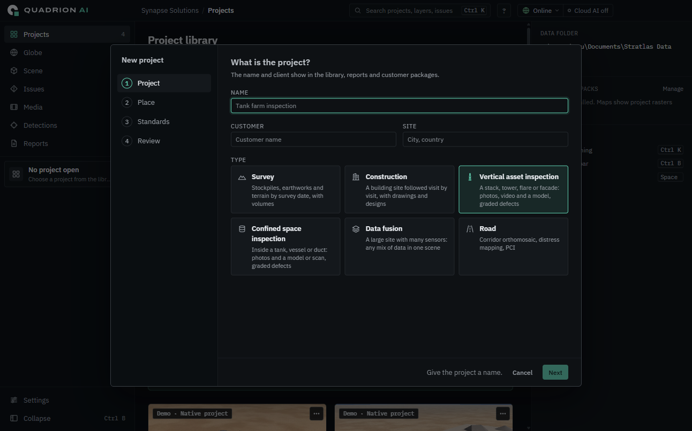

# Building projects

Build a project from raw data: photos, video with its flight log, models, orthos, elevation models and point clouds. Heavy processing runs in the background from the pipeline pack, on this workstation.

## Create a project

1. On **Projects**, click **New project** (or **Ctrl K**, **New project**).
2. **What is the project?** Enter the **Name**, **Customer** and **Site**, and pick the type:
   - **Survey**: stockpiles, earthworks and terrain by survey date, with volumes.
   - **Construction**: a building site followed visit by visit, with drawings and designs.
   - **Vertical asset inspection** (selected at first): a stack, tower, flare or facade, with photos, video and a model, and graded defects.
   - **Confined space inspection**: inside a tank, vessel or duct, with photos and a model or scan, and graded defects.
   - **Data fusion**: a large site with many sensors, any mix of data in one scene.
   - **Road**: corridor orthomosaic, distress mapping, PCI.

   The type sets the starting point: the severity model proposed in step 4, the **Survey data** block of a survey (see [Volumes and roads](09-volumes-and-roads.md)), the road workspace of a road, and the list of what to add first in the empty project. Every tool works in every type, and any kind of data can be added to any project.

   Click **Next**.

3. **Where is it?** Set the origin, the point all positions are measured from:
   - **First GPS photo**: click **Pick a photo**; its GPS position, altitude and date are used.
   - **Typed coordinate**: latitude, longitude and height (`25.1000, 55.2000, 12`), or easting, northing and height.
   - **Click on the map**: click the site on the offline map.

   The **Coordinate reference system** list then selects the matching UTM zone, marked "site zone". Search by zone, country or EPSG code to pick another. Click **Next**.

4. **How are findings graded?** Pick the **Severity model**: **General inspection (1 to 3)**, **Road distress (ASTM D6433)** (preselected for roads), or the model of one of your projects. Click **Next**. Classes you saved to your class library are offered here too (see [Classes](05-annotation-and-issues.md#classes)).
5. **Create the project**: check the summary and click **Create project**. The project opens empty, names its type and lists under **Add first** which data to start with.

Projects made before the types above keep working as they are. An empty one shows what its older type says: **Inspection**, **Survey** (was Volumetric), **Road**, **Digital twin** or **Data fusion** (was Free fusion).

## Import raw data

1. Drag files onto the window, or click **Import files** (or **Ctrl K**, **Import raw data into this project**).
2. {product} takes photos, video with its `.SRT` log, GLB or OBJ models, GeoTIFF orthos and DSMs, point clouds and drawings (see **Drawings** below).
3. Each file reports **Imported**, **Skipped**, **Queued** (a job converts it) or **Failed**.
4. **Cancel** in the import panel stops the import: files already imported stay, the rest are listed as skipped.
5. A GeoTIFF over 300 MB, over 12,000 x 12,000 pixels, or saved as a BigTIFF is **Failed** with the reason: reduce or split it in other software, then import the parts.

- A DJI video with its `.SRT` becomes a clip with its flight path, in sync with the timeline.
- A LAS or LAZ point cloud is converted in the background; **Processing** in the status row at the foot of the left sidebar shows the progress, and the island shows the job beside the date, and the cloud appears when it is done.
- A GLB or OBJ model can be placed with **Georeference a model by point pairs** (**Ctrl K**): click a point on the model (**Pick on model**), then the same point on the scene, map or photo, three times or more; **Apply and save**.

### Camera heights

When photos or a video logged only the height above the take-off point, the **Camera heights** card asks how to place the cameras:

- **Relative altitude + take-off height**: enter **Take-off height H (m)**. {product} proposes it from the model under the take-off point, or from the origin height with a warning.
- **Absolute altitude + datum offset**: enter **Offset (m)**. It is saved as the project's vertical datum.

After the import the panel says which altitude was used and with which number. One take-off height applies to the whole import: import flights that took off at different heights separately.

### 360 video from a 360 camera

{product} takes the files an Insta360 camera writes, without Insta360 Studio in between.

1. Drag the `.insv` file onto the window, or pick it with **Add data**. The camera's low resolution copy (`LRV_...lrv`) can come along: it is skipped, because the full clip is imported.
2. The two lens pictures are stitched into one 360 video for playback (at most 3840 x 1920). The import panel shows the progress; a minute of footage takes about a minute or two, and **Cancel** stops it. Other files of the same drop are saved in the project before the stitch starts; they show when the import has ended. The original stays where it is.
3. The video appears in **Datasets** under **360 walks**, in the folder of its survey date when the camera's date matches one. Click it: the **Scene** opens in **Split** with the **360 video** pane on the right.
4. Drag in the pane to look around and scroll to zoom. The bar below plays, pauses and scrubs; **Sound** turns the sound on. The keys are those of the video window: **Space** or **K**, **J**, **L**, comma and period.

- A video that is already stitched (an equirectangular MP4 exported from Insta360 Studio or another program) comes in like any other file: through **Add data**, a drop on the window or a folder import, and it becomes a walk under **360 walks**. **Ctrl K**, **Add 360 video** also takes it, and `.insv` files. A video that is not 360 and has no drone telemetry next to it is skipped, and the import panel says why. The panel says where each file went.
- Stitching uses the **ffmpeg** that comes with the processing tools (pipeline pack 0.6.0 or later), so there is nothing else to install. With an older pack or none, {product} looks for ffmpeg on this computer instead; when there is none the import says so and adds nothing: update the processing tools in **Settings**, **Processing tools**, and import again.
- An `.lrv` imported without its `.insv` plays at its own low resolution.
- A video stitched from the camera's own file plays **unstabilised**: every shake of the walk is in it, and the pane marks it **Not stabilised**. For a steady picture, export the clip from Insta360 Studio with FlowState on and bring that MP4 in with **Add 360 video**.
- A 360 video travels inside a package, and older versions of {product} open the project without showing it.

### Placing a 360 walk

A walk is placed on a drawing, on the map (when the project has a coordinate system) or in the 3D view, so you see where the camera was and which way it looked. You set where the walk started and where it ended; {product} lays the walk's whole shape, as worked out from the video, between the two.

1. Point at the walk's row under **360 walks** and press **Place walk** (the pin button). Its badge says **Needs placing** until it is placed. A placed walk shows **Edit placement** instead, which opens the same tools with the walk as saved.
2. A walk that is not processed yet has no known shape. The toolbar says why (not processed, still processing, failed or stopped) and offers **Process walk** (or **Process again**). **Place between two points anyway** places it without its shape: the walk then runs in a straight line between your two points, and the toolbar says so.
3. Choose where to place it in **Place on**: a drawing (shown beside the 3D view), the **Map** or the **3D view**. A slim toolbar sits above it. When the walk has no survey date yet, the toolbar has a **Survey date** field; Save applies it.
4. Move the pointer over the surface: a faint copy of the walk's shape follows it. Click where the walk started. Now the shape turns and scales between the start and the pointer. Click where it ended. An end closer than 5 m to the start is not taken, and the toolbar says so.
5. The walk is placed with a **Start** and an **End** handle. Drag either one: the shape follows while you drag. **Save** keeps the placement. The walk then shows on every drawing of the area (or on the map and in the 3D view), and the 360 video shows north (**N**) at its top edge.
6. For a closer fit, press **Fine-tune**: the 360 video opens beside the surface. Scrub to a moment where you know the spot, press **Pin here** and click the spot. **Align view** turns the view: click a landmark in the 360 video, then the same landmark on the surface. The **Heading** field turns it by hand (arrow keys 1 degree, Shift 10).

- **Remove placement** in the row or in the toolbar asks in place, then takes the walk off the drawing, the map and the 3D view. The walk and its video stay.
- **Cancel** with changes not saved asks "Keep these changes?" in the toolbar.
- **Remove walk** (the bin button) asks first, then moves the walk's files to the project's trash folder, where they stay seven days.

### Drone panoramas

A drone's own panorama mode writes a set of photos for each sphere. {product} groups them, stitches each sphere into one panorama and places it where the drone flew.

1. **Add data**, then **Add drone panoramas**, and choose the folder with the frames. A scan lists the spheres it found: how many frames, when and how high above the ground, and whether each is a **Wide panorama**, a **Ready-made panorama** or **Incomplete**. A sphere already in the project says **Already in** its layer.
2. The preview shows **Where the panoramas sit** on a small map. Tick the spheres to bring in, then set the **Survey date**, the **Layer name** and the **Quality**: **Standard (8K)** or **High (16K)**. Click **Import**. The frames are copied into the project first; the originals stay where they are.
3. Each panorama shows in **Datasets** under its layer with its status: **Waiting to stitch**, **Stitching** with a percentage, **Stitched** or **Stitch failed** with the reason. Several can wait at once; they stitch one after another, and you can keep working.
4. Click a stitched panorama's row, or its **Open** button, to look around inside it. **Fly to** moves the 3D view to where it was taken. A panorama that is not stitched says **Not stitched yet**; **Stitch** on its row starts it again.
5. When you drop a folder of drone frames through **Add data** or on the window, {product} offers **Import as panoramas**, **Skip these frames** or, for a set that is not panorama frames, **Import as photos anyway**.

- To remove drone panoramas, remove their layer in **Datasets**. The confirm lists what goes; any stitch still running stops first, then the panoramas, their source frames and stitched images move to the project's trash folder, where they stay seven days. Removing a single panorama from a layer comes later.
- Stitching needs the processing tools (pipeline pack 0.7.0 or later, see [Settings](12-settings.md#processing-tools)).

## Drawings

A plan, a layout or any other sheet comes in as a drawing: PDF, PNG, JPEG, WebP, SVG, TIFF or DXF. DWG is not supported: save it as DXF or PDF, or as a PNG picture.

1. In **Datasets**, click the **Add drawing** button beside **Add data** (or the **+** on the **Drawings** group, or **Ctrl K**, **Add a drawing to this project**) and pick the files. A PDF or a PNG dropped on the window, or picked through **Add data**, goes to Drawings too. A JPEG is a photo, and a GeoTIFF an ortho, unless you use **Add drawing**.
2. A PDF with several pages asks **Pages** and proposes the first one. Type the ones you want, for example `1-3, 7`. Each page becomes one drawing, and a drawing cannot be removed again yet, so bring in only the pages you need. One import takes at most 20 pages.
3. The drawings appear in the **Drawings** group. A picture or a PDF page says "not placed" and is hidden in the 3D view and on the map until you place it.

Each drawing row has a settings button. It opens the drawing's controls under the row:

- **Side by side** opens the split with the drawing on the right and the view you were in on the left. In the pane's list, drawings come first under **Drawings**, and each PDF page is its own entry. Drag to pan, scroll to zoom, double-click to fit.
- **Place on the site** puts a picture or a PDF page where it belongs. The split opens with the 3D view on the left and a strip above the drawing. Click a point on the drawing, then give the same spot on the site: click it in the **3D view**, click it on the small **Map**, or choose **Typed** and enter easting and northing (or latitude and longitude). Do this for two points or more, far apart. The strip shows how far each pair is off. **Place** saves it: the drawing shows on the site and "not placed" goes. **Place again** starts over.
- **Opacity** makes the drawing more or less see-through in the 3D view and on the map.
- **On top in 3D** draws the drawing over models and point clouds, which otherwise hide the parts of it that lie under them. Measurement lines, outlines and labels stay on top of it.

A DXF drawing is placed in the model builder, which also reads parts from it: see [Models from drawings and point clouds](18-model-builder.md).

## Processing

Heavy work runs in the background on this computer: making maps from photos, comparing survey dates, converting a point cloud, an AI inspection. It always belongs to the project it was started in.

**Processing**, in the status row at the foot of the left sidebar, shows what the open project is doing: "Processing 40%" while one thing runs, "Processing · 3 running" for several, and a warning mark with "1 needs attention" when something failed or was interrupted. With no project open it shows only while another project is still working ("Processing · 1 running elsewhere").

Click it to open the drawer:

- **Create maps from photos** turns drone photos into maps and a 3D model: see [Creating maps from photos](28-processing-photos.md).
- **Running** and **Finished** list this project's work, newest first. Each line has a tag: **Maps and models**, **Survey**, **AI analysis**, **Files** or **System**.
- **Maps from photos** lists the project's runs, with **Open run**, **Create maps again**, **Export as OPF** and **Delete work files**.
- **Running in other projects** appears only when another project is still working. Each line names its project.

Click a line to see its steps and progress. **Cancel** stops it. After a failure, a cancel or an interruption (quitting {product} while it ran), **Resume** carries on from the next step. **Open output** and **Log file** show what it wrote. **Settings used** and **Log** are folded away until you open them. **Back** returns to the list.

Everything else starts where the work is: compare dates and survey tools on the **Scene**, imports from **Import files**, the AI inspection from **Detections**, a road survey from its setup panel.

Processing writes into the open project, always with a backup, and never drops your own issues.

The list is kept on this computer for the project's folder. A project that was moved, or opened on another computer, starts with an empty list; its maps, runs and reports are all still there.

The processing tools themselves are installed and updated in **Settings**, **Processing tools**: see [Processing tools](12-settings.md#processing-tools).

## Review detections

Detections are boxes or outlines on photos and video frames, from you, a model or cloud AI. Every pass is a file in `detections` in the project folder.

1. Click **Detections** in the sidebar. The top reads, for example, "9 waiting · 8 accepted · 0 rejected".
2. **Photos shown**: **With detections** or **All photos**. Pick a photo on the contact sheet.
3. For each box:
   - **Accept** (**A** or **Enter**): it becomes a draft issue. **Open in Issues** shows it.
   - **Link** (**L**): find an issue by code or title; the box becomes another sighting of it.
   - **Reject** (**X**) a false alarm. **Reopen** takes the decision back.
4. Set **Class** (**C**), **Severity** (number keys), **Uncertain (U)** and **Note (N)** in the inspector.
5. When the detector named something the project has no class for, the inspector shows what it said and **Create class 'name'**. One click makes the class; every detection with that word takes it.
6. **Accept all (N)**, with N the waiting detections in the list you are looking at that have a class and a severity, turns each of them into a draft issue (filter and minimum confidence applied), after a question that also says how many are skipped for lack of a class or severity. **Reject all (N)** rejects every waiting detection in the list. Each is one step: **Ctrl+Z** in the review undoes the whole batch.
7. **J** and **K** step through the detections. The confidence slider hides proposals under "Confidence N% and up".

**Ctrl Z** and **Ctrl Y** undo and redo. **Ctrl**+click selects several tiles; **Clear selection** empties it. The state reads **Saved** once your decisions are written into the detection file.

On an inspection project, **Turn detections into issues** on the **Detections** screen places the accepted detections on the model and groups them into issues. It asks only for the inspection's own options, then runs for the open project; the **Processing** drawer opens on it. **Turn detections into issues** never makes a second issue for the same box.

## Detect with AI

Needs cloud AI on and a key with a vision model (see [AI agent](07-ai-agent.md)).

1. On **Detections**, **Ctrl**+click a few photos, then **Detect with AI**.
2. **What to send**: the selected photos, the photo in the editor, all photos without detections, or **Video frames** (a **Clip** and **One frame every** N **seconds**). Set **Images per request** and, optionally, **What to look for**.
3. Read the **Estimate** of tokens and cost.
4. **What leaves this workstation** shows thumbnails of exactly the images that go out; **Instructions and request text** shows the full request.
5. Click **Send**. **Stop** stops it. When it is **Done** you see the tokens and the cost.

Results arrive as **Waiting** detections ("Proposed by" the model, with a confidence). Nothing counts until you accept it.

When none of the project's classes fits, the model may suggest a new one. The inspector shows **Suggested class: name** with **Create class**; nothing is created until you click it. The assistant can suggest a class too; it asks for your approval first.

To find defects with a model on this computer instead, with nothing sent and no cost, pick **Local model** under **Detect with**. See [Local detection with ONNX models](19-local-detection.md).

## Calibrate video

When the video does not sit on the model, calibrate it: **Ctrl K**, **Calibrate video: time offset and field of view**.

- **Time offset**: scrub to a visible event (a turn, a vehicle, the take-off) and nudge until the frame and the model move together.
- **Field of view**: widen or narrow the model view until edges line up.
- **Orientation** (**Pitch**, **Yaw**, **Roll**) and **Position** (**East**, **North**, **Up**, metres) offsets, each with a live preview.
- **Point pairs**: click a sharp feature in the frame, then the same feature on the model (or type its coordinate), **Add pair**. Three to six pairs across the frame, then pick **Values to fit** and click **Fit**. **Before fit**, **Error now** and **Held out** show how well it fits.
- **Refine automatically** lines the frame up with the model by their edges. On busy plants it may say the edges do not agree: use point pairs.

Click **Save calibration**. Tick "Use this orientation and position for all ... clips of this flight" to apply it to the whole flight. **Reset** goes back to the saved values.
