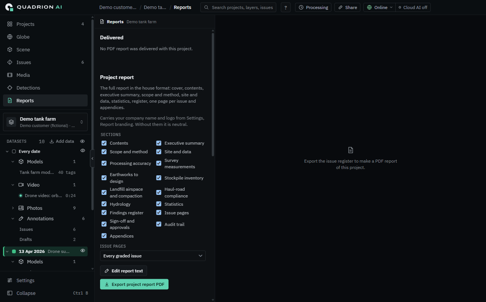

# Reports and exports

**Reports** holds the delivered PDF reports of a project, the project report you generate, the issue register and the customer package.

## Report branding

Your company name and logo go on every report {product} generates. Delivered reports are never changed.

1. Open **Settings**, **Report branding**.
2. Type the **Company name** and press **Enter**.
3. **Choose logo**: PNG, JPG or SVG up to 5 MB. It is kept on this workstation, never in a project folder.
4. Optional: an **Accent colour** for the cover and headings. **Reset** uses the house colour.

The **Cover preview** shows the result. Without branding, reports are neutral: the project name, no logo, and a small "Made with {product}" line.

## Report text

The project report prints an executive summary, the method and a findings overview. Write them once per project:

1. **Reports**, **Report text**, **Edit report text**.
2. Start the text:
   - **Fill from template** writes the facts from the project statistics. Replace the parts in [brackets].
   - **Draft with AI** (cloud AI on) writes a draft. The first time, a preview shows exactly what is sent: the instructions and the statistics, no photos, positions or notes. Click **Send**.
3. Edit the text and click **Save version**.

**Versions** lists every saved version (**AI draft**, **Template**, **Edited**); **Restore this version** brings one back. **Back to the reports** returns.

## Project report

The full report in the house format: cover, contents, executive summary, scope and method, site and data with a locator map, statistics, findings register, one page per issue and appendices.

1. **Reports**, **Project report**.
2. Tick the **Sections** you want.
3. **Issue pages**: **Every graded issue**, **All but the lowest level** or **None, register only**. Road surveys default to all but the lowest level.
4. Click **Export project report PDF** and choose where to save it.

Stockpile projects add the stockpile map and the volume table; road projects the road ratings. A project with no issues still prints.

## Volumetric report

The hand-over of a stockpile site for a customer: the piles with their figures, pictures and profiles, and texts you can edit. The figures are the ones **Project**, **Volumes** shows.

1. **Reports**, **Customer reports**, **Open volumetric report**. The editor opens with a live preview.
2. Edit the texts: **Title**, **Prepared for**, **Prepared by**, **In short**, **Intro**, **Method note**, **Pile notes** and **Closing remarks**. **In short** and the method note are written from the figures and follow them until you edit them; **Reset to generated** brings the generated text back. **Compare with** picks the survey date the change is measured from.
3. Under **Pages**, switch **A. Cover and summary**, **B. Site overview and pile pages** and **C. What changed** on or off. At least one page stays on.
4. Click **Export PDF**, or **Export HTML** for one file that opens offline, and choose where to save it.

The export takes the report's pictures itself when there are none yet or the data changed since they were taken. The 3D view opens and a card says what is being pictured ("Site, ..." and then "Pile 4 of 31: ...") with "Picture 12 of 97" and a bar. Then it reads "Writing the PDF" or "Writing the HTML file", and your view comes back as you left it. **Stop taking pictures** ends the run after the current picture: nothing is saved, the pictures you had stay, and no file is written. While the file is written the button is greyed out. An export with pictures that are still current takes none and writes the file at once.

Until the first export the preview has no pictures, and a line above it says "Pictures are taken when you export." **Take them now** on that line takes them at once, so you can check the preview first. After the data changed the line reads "The data changed since the pictures were taken.", with the same link. Every run takes the whole set again.

What the report holds:

- **Summary.** The title band with the number of piles ("8 piles, 3 measured" when some have no volume), the stock on hand, the change and "In short". The table lists every pile of the project. A pile without a volume reads "Not computed" and is left out of every sum. When two outlines share half or more of the smaller one, a line under the table names the two piles and says the site total may count the same material twice.
- **Site overview.** The site photo, the elevation map and the 3D view from the south-east, each with the pile numbers. Numbers that would sit on top of each other are moved apart, with a line to their true place.
- **Pile pages**, two piles per page. Each pile has its volume and the change since the compared survey; the photo with its outline and the A to B profile line, the 3D picture and the compared survey's photo; the elevation profile with both surveys and the base; then footprint, base, base level, peak height, density and survey date. The 3D picture always shows the latest survey, also for a pile filed under an earlier date.
- **What changed.** The before and after photos, the cut and fill picture, a bar per pile, and the method note once at the end. Without this page (one survey date, or the page switched off) the closing remarks and the method note end the last pile page; when that page holds two piles they print on a page of their own.

A pile with a negative volume (the surface lies below its base) prints the volume as computed with the note "The surface is below the base here. Check the base." Its change is given in cubic metres without a percentage. A pile at or under zero prints no tonnes in its table row, on its card, in the HTML file's interactive view or in that view's CSV. It still counts in the site totals, cubic metres and tonnes, so the report's totals equal the app's.

The HTML file also has an interactive view: switch the date, the view (Photo, Cut & fill, Elevation, 3D) and the units, pick a pile, **Download CSV** and **Save as PDF**. Pile numbers that would sit on each other on the map are moved apart there too, each with a thin line to its true place, also when the browser window is made narrow. It works without a network.

The same exports are on the **Exports** screen and under **Ctrl K** as **Volumetric report (PDF)** and **Volumetric report (HTML)**; they take the pictures the same way.

A package exports the report with the pictures it carries, because a package cannot take new ones. When those pictures may not match the package's data, the line above the preview says so and a message says it again after the export. A package made from a project whose report was never exported carries no pictures, and its export is refused with that reason. So export the report once from the project folder before you make a package.

Two limits on very large sites. The report keeps up to 512 pictures, which is the site pictures and three pictures each for 168 piles on two survey dates; the piles past that, the smallest, have their photos cut from the site photo and the line "No 3D picture: the report pictures the 168 largest piles". The HTML file is at most 15 MB: with many piles the pile pictures are made smaller first, then the site pictures, and past that the export says to export a PDF instead, which has no such limit.

## Issue register

**Reports**, **Issue register**, **Export issue register PDF**: every issue with its photo, severity and note, with your branding.

## Export issues and views

On **Issues**, **Export** saves:

- **Issues CSV**: one row per issue, for spreadsheets.
- **GeoJSON**: issues on the map, for GIS.
- **COCO JSON**, **Kit JSON** and **Masks ZIP**: detections and masks for other tools. The register and its reports hold only the findings you confirmed in **Inspect**; AI suggestions you have not accepted stay out.
- **Issue register report (PDF)** and **Project report (PDF)**.
- **3D view snapshot (PNG)**, with or without **Legend on the 3D snapshot**.

**Ctrl K** finds the same exports: type "export".

## Customer packages

To send a whole project to a customer who opens it in {product} without editing it, see [Packages](11-packages.md).
